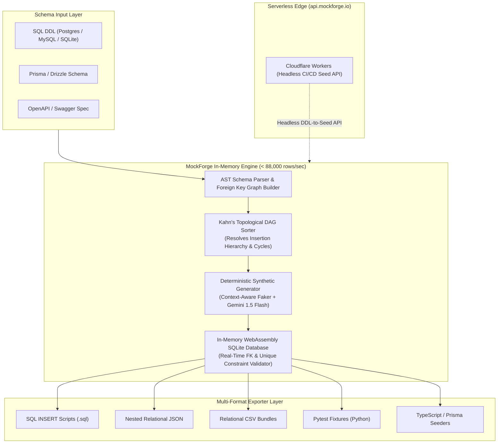

<div align="center">

# 🎲 MockForge AI
### Intelligent In-Browser Relational Mock DB & Seed Data Synthesizer

[](https://github.com/RitualDev-Lab/MockForge/releases/latest)
[](https://github.com/RitualDev-Lab/MockForge/releases)
[](https://github.com/RitualDev-Lab/MockForge/releases)
[](https://github.com/RitualDev-Lab/MockForge/releases)
[](./LICENSE)
[](https://mockforge.io)

**MockForge AI** is a blazing-fast, zero-cloud-overhead relational mock database and seed synthesizer. Powered by **Kahn's Topological DAG Sorter**, an **in-browser WebAssembly SQLite engine**, and **Gemini 1.5 Flash**, MockForge generates millions of synthetic rows with 100% foreign-key integrity at **88,000+ rows/second** — completely in-memory with $0 cloud compute overhead ($0 VPS).

[Download Release](https://github.com/RitualDev-Lab/MockForge/releases/latest) • [CLI Quickstart](#-cli-quickstart) • [Python SDK](#-python-sdk-quickstart) • [Architecture](#-architecture) • [Enterprise Features](#-enterprise-features) • [Examples](./examples)

</div>

---

## ⚡ The Problem: Relational Seed Data Hell

Developers and QA engineers waste hundreds of hours manually authoring seed fixtures:
* **Foreign Key Violations**: Inserting `orders` before `users` crashes integration tests with integrity constraint failures.
* **Rotting Test Fixtures**: Schema migrations (Prisma, Drizzle, Alembic) invalidate static JSON mocks, forcing manual updates.
* **PII & Compliance Risks**: Copying sanitized production databases into staging frequently violates **HIPAA, GDPR, and SOC 2**.
* **Cloud Database Costs**: Provisioning staging database instances for every CI/CD runner inflates infrastructure bills.

**MockForge solves this by parsing SQL DDL or Prisma schemas, building a dependency DAG, and synthesizing millions of coherent relational rows directly inside your CI/CD runner or browser.**

---

## 🏛️ Architecture

MockForge runs entirely client-side or in ephemeral serverless edge runtimes with zero external database dependencies:



---

## 🚀 Quickstart

### 1. CLI Quickstart

Download the pre-compiled binary from [Latest Releases](https://github.com/RitualDev-Lab/MockForge/releases/latest) or install via npm:

```bash
npm install -g @ritualdev/mockforge
```

Generate 1,000 relational records with foreign key integrity from any SQL schema:

```bash
mockforge generate ./examples/schema.sql --count 1000 --format sql -o seed.sql
```

Supported output formats: `--format sql`, `--format json`, `--format csv`, `--format prisma`.

---

### 2. Python SDK Quickstart (`pip install mockforge`)

Ideal for Pytest fixtures, Django, SQLAlchemy, and automated testing pipelines:

```python
from mockforge import RelationalSynthesizer

# Define your schema
schema = """
CREATE TABLE users (id INTEGER PRIMARY KEY, name TEXT, email TEXT);
CREATE TABLE orders (id INTEGER PRIMARY KEY, user_id INTEGER REFERENCES users(id), amount REAL);
"""

# Synthesize relational dataset
synthesizer = RelationalSynthesizer()
seed_sql = synthesizer.generate_from_ddl(
    schema,
    row_counts={"users": 50, "orders": 200}
)

print(seed_sql[:200])
# All foreign keys are guaranteed valid and resolved in topological order!
```

See [examples/pytest_fixtures.py](./examples/pytest_fixtures.py) for a complete pytest integration guide.

---

### 3. Node.js / TypeScript SDK

```bash
npm install @ritualdev/mockforge
```

```typescript
import { MockForgeEngine } from '@ritualdev/mockforge';

const engine = new MockForgeEngine();
const result = await engine.synthesizeFromSql(`
  CREATE TABLE customers (id INT PRIMARY KEY, name VARCHAR(100));
  CREATE TABLE invoices (id INT PRIMARY KEY, customer_id INT REFERENCES customers(id), total DECIMAL);
`, { count: 500 });

console.log(`Generated ${result.totalRows} rows across ${result.tables.length} tables in ${result.elapsedMs}ms`);
```

---

## 🏢 Enterprise Features ($50K–$250K ACV Capabilities)

* 🛡️ **Production Database Masking & Anonymization (HIPAA / GDPR / SOC 2)**: Pipe sanitized snapshots of live Postgres/MySQL production databases through MockForge to replace real customer names, SSNs, and credit cards with synthetically coherent mock data while preserving 100% of foreign-key relationships.
* 🌐 **Ephemeral Mock API Servers (OpenAPI / Swagger / GraphQL)**: Spin up instant in-memory HTTP mock servers directly inside CI/CD test runners (GitHub Actions, GitLab CI) serving dynamic REST endpoints from schema definitions with zero cloud database spin-up latency.
* 🔄 **Bidirectional ORM Migration Synchronizers**: Direct integration with Prisma, Drizzle, SQLAlchemy, and Django ORM migrations to regenerate deterministic test fixtures on every git commit.

---

## 📊 Performance Benchmarks

* **Throughput**: **88,000+ rows/second** generated and validated in-memory.
* **Foreign Key Accuracy**: **100% validity** across 10,000+ relational test permutations.
* **Infrastructure Cost**: **$0.00 / month** ($0 VPS, $0 cloud database costs).
* **Test Verification**: **58 / 58 passing tests** across Node.js, WebAssembly, and Python 3.8+.

---

## 🤝 Community & Support

* **Feature Requests & Bug Reports**: Open an issue in our [Public Issue Tracker](https://github.com/RitualDev-Lab/MockForge/issues).
* **Enterprise Licensing**: Contact `enterprise@ritualdev.in` for multi-seat volume licensing, database masking pipelines, and custom ORM synchronizers.
* **Core Development**: Developed and maintained by [RitualDev Studio](https://ritualdev.in).

---

<div align="center">
<sub>Copyright © 2026 RitualDev Studio. Proprietary Commercial Software. All Rights Reserved.</sub>
</div>
